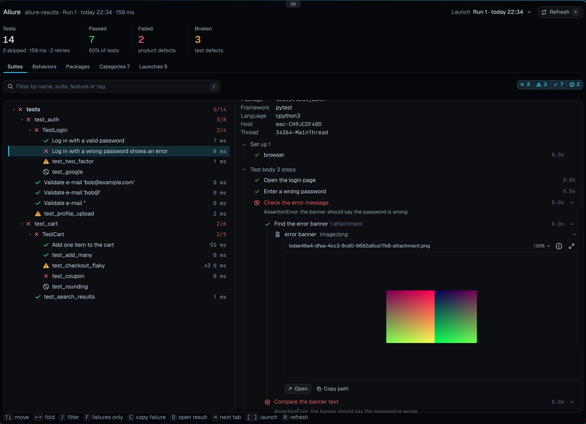

# Tern plugins

Plugins for [Tern](https://docs.stencil.so/tern/), the terminal by Stencil. Each one is a
folder with a `plugin.toml` and Luau sources, installed straight from this repository;
Todo + Jira, a fork of someone else's plugin, keeps its code in its own repository.

<table>
  <tr>
    <td width="50%" valign="top">
      <h3><a href="tern-searcheverywhere">Search Everywhere</a></h3>
      <p>Tap <b>Shift</b> twice and jump to any file, class, function or variable in the
      folder you're in. JetBrains-style matching: <code>fbn</code> → <code>findByName</code>,
      <code>Model.save</code>, <code>views.py:10</code>.</p>
      <a href="tern-searcheverywhere"></a>
    </td>
    <td width="50%" valign="top">
      <h3><a href="tern-testview">Test Explorer</a></h3>
      <p>Finds pytest, unittest, vitest and jest tests, runs them, and shows each failure's
      trace next to the source line. When an agent runs the tests, it opens beside the
      agent and fills in live.</p>
      <a href="tern-testview"></a>
    </td>
  </tr>
  <tr>
    <td colspan="2" valign="top">
      <h3><a href="tern-todo">Todo + Jira</a></h3>
      <p>A to-do list whose tasks open omp agents in Tern panes, with your Jira sprint in a
      Tickets tab. Enter on a ticket starts an agent on it; marking the task done moves the
      issue to Done in Jira.</p>
    </td>
  </tr>
  <tr>
    <td width="50%" valign="top">
      <a href="tern-todo"></a>
      <p align="center"><sub>Start a ticket, mark it done, Jira follows</sub></p>
    </td>
    <td width="50%" valign="top">
      <a href="tern-todo#connect-jira"></a>
      <p align="center"><sub>Connect Jira, pick the project and board</sub></p>
    </td>
  </tr>
  <tr>
    <td width="50%" valign="top">
      <h3><a href="tern-omp-sessions">omp Sessions</a></h3>
      <p>Every omp session on the machine as a folder tree, not just the ones started in the
      folder you're in. Filter by title or folder, see each session's size and age, and
      resume one in a new tab or a split.</p>
      <a href="tern-omp-sessions"></a>
    </td>
    <td width="50%" valign="top">
      <h3><a href="tern-git-identity">Git Identity</a></h3>
      <p>Pick which git user a repository commits as, from the identities on the machine or
      a new one you add. It sets the repository's own <code>user.name</code> and
      <code>user.email</code>, so Tern's git block, agents and the terminal all use it.</p>
      <a href="tern-git-identity"></a>
    </td>
  </tr>
  <tr>
    <td width="50%" valign="top">
      <h3><a href="tern-allure">Allure Report</a></h3>
      <p>Finds the <code>allure-results</code> folders of a workspace and shows every launch as
      a report: suites, behaviors and categories, steps that fold open to their attachments,
      retries and history across runs. It fills in live as tests write their results.</p>
      <a href="tern-allure"></a>
    </td>
    <td width="50%" valign="top">
      <h3><a href="tern-databases">Databases</a></h3>
      <p>Saved connections to PostgreSQL, SQLite, Trino and Redis, their passwords in the
      system keychain. Browse tables and keys, write queries with completion, cancel them on
      the server, or write a <code>?</code> line and the agent of your session writes the
      query in the editor.</p>
      <a href="tern-databases"></a>
    </td>
  </tr>
</table>

## Install

```sh
tern plugin install github.com/sneaky-bulgarian/tern-plugins/tern-searcheverywhere
tern plugin install github.com/sneaky-bulgarian/tern-plugins/tern-testview
tern plugin install github.com/sneaky-bulgarian/tern-plugins/tern-omp-sessions
tern plugin install github.com/sneaky-bulgarian/tern-plugins/tern-git-identity
tern plugin install github.com/sneaky-bulgarian/tern-plugins/tern-allure
tern plugin install github.com/sneaky-bulgarian/tern-plugins/tern-databases
tern plugin install github.com/sneaky-bulgarian/tern-todo
```

`tern plugin list` shows what loaded; `tern plugin remove <id>` takes one out again.
Built and tested with Tern 0.9.12; omp Sessions, Git Identity and Allure Report with 0.9.13;
Databases with 0.9.14.

| Plugin | Opens with | What it does |
| --- | --- | --- |
| [Search Everywhere](tern-searcheverywhere) | <kbd>⇧</kbd> <kbd>⇧</kbd> | Files and declarations in 17 languages, indexed in the background |
| [Test Explorer](tern-testview) | <kbd>⇧</kbd><kbd>⌘</kbd><kbd>U</kbd>, or by itself when tests run in a pane | Test tree, run all / file / one / failed, traces with source; follows agents' pytest and unittest runs |
| [Todo + Jira](tern-todo) | **Todo: open tasks** in the palette | Tasks that open omp sessions in panes; the active Jira sprint as tickets, closed in Jira when their tasks are done |
| [omp Sessions](tern-omp-sessions) | <kbd>⇧</kbd><kbd>⌘</kbd><kbd>H</kbd>, **sessions** in the status line, or the Files pane's clock button | omp sessions from every folder as a tree, with filter, size and age; resume in a tab or split |
| [Git Identity](tern-git-identity) | <kbd>⇧</kbd><kbd>⌘</kbd><kbd>Y</kbd>, **git user** in the status line, or the Files pane's person button | Choose or add the git user a repository commits as |
| [Allure Report](tern-allure) | <kbd>⇧</kbd><kbd>⌘</kbd><kbd>J</kbd>, **Allure** in the status line, or the Files pane's chart button | Allure results as launches, with suites, behaviors, categories, steps, attachments, retries and history |
| [Databases](tern-databases) | <kbd>⌥</kbd><kbd>⇧</kbd><kbd>⌘</kbd><kbd>D</kbd>, **Databases** in the status line, or **Open with Databases** on a SQLite file | Connections to PostgreSQL, SQLite, Trino and Redis with keychain passwords; tables and keys, completion, results; a `?` line asks the session's agent for the query |

## Develop

Link a checkout instead of installing, and Tern reloads the plugin on every save:

```sh
git clone https://github.com/sneaky-bulgarian/tern-plugins
tern plugin link tern-plugins/tern-searcheverywhere
```

`tern plugin types <dir>` writes `tern.d.luau` (already in each folder) for
[luau-lsp](https://github.com/JohnnyMorganz/luau-lsp):

```sh
luau-lsp analyze --platform=standard --definitions=@tern=tern.d.luau *.luau
```

## License

[MIT](LICENSE)
