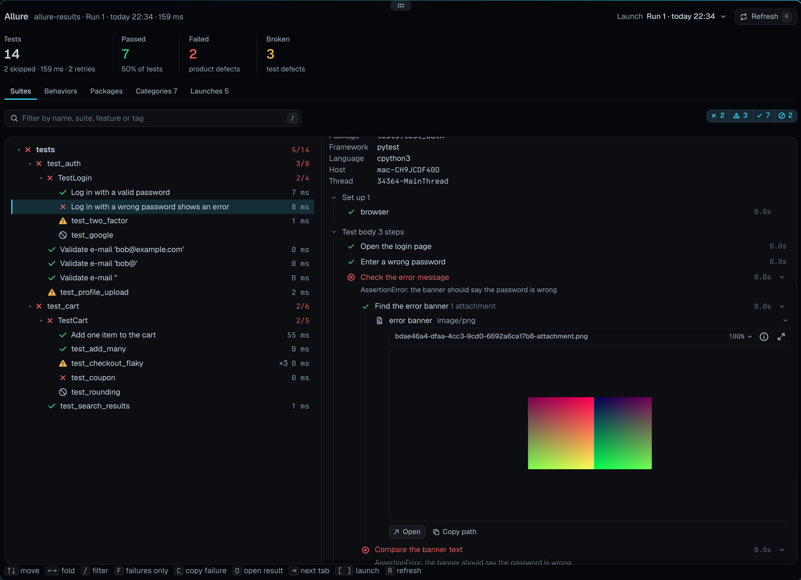
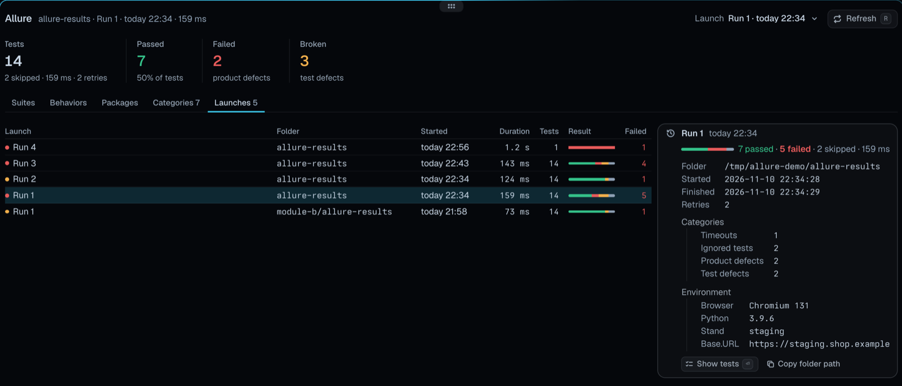

# Allure Report

**Allure test results as a native report in [Tern](https://docs.stencil.so/tern/).** It finds the
`allure-results` folders of a workspace, splits them into launches (separate test runs), and shows
each launch the way Allure's HTML report and Allure TestOps do: suites, behaviors, packages and
categories, every test's steps folded and unfolded in place, attachments right under the step that
made them, retries and history across runs. It follows the folders as tests write them.

<p align="center">
  
</p>

## Install

```sh
tern plugin install github.com/sneaky-bulgarian/tern-plugins/tern-allure
```

## Open it

- Palette: **Open Allure report** (<kbd>⇧</kbd><kbd>⌘</kbd><kbd>J</kbd>) opens it beside the focused
  pane, for that pane's workspace, or focuses the report already showing it.
- Status line: click **Allure** (shown when Settings › Status line is on). It is dimmed unless the
  focused pane's folder, or one above it up to the git checkout, has `allure-results`,
  `build/allure-results` or `target/allure-results`.
- Files pane: the chart button in its header opens the report for the selected folder. An
  `allure-results` folder opens on its own, unless a report of its workspace is open, which then
  moves to that folder's newest launch. **Open with Allure Report** on a `*-result.json` file opens
  it on that test.

## What it reads

- **Folders.** The workspace is the git checkout containing the folder you open it from. It is
  searched 7 levels deep for folders named `allure-results*` and for any folder holding
  `*-result.json` files (`node_modules`, `.git`, virtualenvs, caches and `allure-report` are
  skipped), again every 30 seconds. Gradle's `build/allure-results`, Maven's
  `target/allure-results` and per-module folders all show up, each as its own source.
- **Results.** Allure 2 result files from any adapter (pytest, JUnit, TestNG, Playwright, Jest,
  Vitest, Cucumber, …): `*-result.json`, the fixtures in `*-container.json`, `categories.json`,
  `environment.properties` (or `environment.xml`) and `executor.json`.
- **Launches.** Results that accumulate in one folder (runs without `--clean-alluredir`) are split
  into launches: a new one starts when results come from a new process after a pause of a few
  seconds (the pid in the `thread` label of the pytest and JVM adapters), or after five minutes of
  silence. Within a launch, results of the same test (`historyId`) are attempts: the latest is the
  test's result, the earlier ones its retries, and a test that passed after failing is flaky.
- **Live.** The folders are listed again every 2 seconds. New results show as the tests write them,
  a **Live** badge says so, and when a new launch starts while you look at the newest one, the
  report moves to it.

## What it shows

<p align="center">
  
</p>

The head row names the launch and switches between launches; under it are the launch's counts and
five tabs:

| Tab | Groups tests by |
| --- | --- |
| Suites | `parentSuite` › `suite` › `subSuite` |
| Behaviors | `epic` › `feature` › `story` |
| Packages | `package`, then the test class |
| Categories | The categories of `categories.json` (their message and trace patterns too), then Product defects and Test defects, then the failure message |
| Launches | Every launch of every folder, with the selected launch's folder, times, executor, categories and environment |

The filter matches names, full names, suites, behaviors, packages, owners and tags; the status
buttons beside it hide and show failed, broken, passed, skipped and unknown tests.

A test shows its status, flaky, known and muted marks, the error message and stack trace, labels,
links, description and parameters, then **Set up** (fixtures from the containers), **Test body**
and **Tear down** as step lists. Steps fold open in place to their nested steps, parameters,
failure and attachments; the failing path starts open. **Retries** lists the other attempts in the
launch (pick one to see it), **History** the test in every other launch.

Attachments open in place:

| Kind | Shown as |
| --- | --- |
| Images, video, PDF | Tern's media viewer |
| JSON, XML, HTML, YAML, code, logs, text | Highlighted text (the first 512 KB) |
| CSV, TSV | A table |
| URI lists | Links |
| Screenshot diffs (`application/vnd.allure.image.diff`) | Expected, actual and diff side by side |

Anything else opens in Tern with **Open**.

| Key | Does |
| --- | --- |
| ↑ ↓ / j k | Move |
| ← → / h l | Fold and unfold groups |
| Space, Enter | Fold or unfold the selected group |
| / | Filter (Enter keeps it, Esc clears it) |
| F | Failures only, or everything again |
| Tab, ⇧Tab, 1–5 | Switch tabs |
| [ ] | Older or newer launch |
| C | Copy the failure |
| O, double-click | Open the test's result file |
| R, F5 | Read everything again |

## How it works

`host.luau` is the `report` block. `results.luau` finds the folders with one `find`, reads their
files in time slices (so a folder of thousands of results stays responsive), keeps only a summary of
each result, and builds launches, retries and categories; a selected test's full result and its
fixtures are read when it is shown. `regex.luau` matches `categories.json` patterns the way Allure
does (Java's `Pattern.matches`, dot matching newlines). `tree.luau` groups a launch for each tab,
`view.luau` and `detail.luau` draw the page, and `window.luau` adds the command, the status segment
and the Files pane button.

Limits: Allure 1 results (`*-testsuite.xml`) are not read; category patterns with lookaround or
Unicode classes match nothing (the Launches tab names them); launch splitting is a heuristic, so
two runs a moment apart without a pid in their labels read as one launch with retries.

## Develop

```sh
tern plugin link .          # reloads on every save
tern plugin types .         # tern.d.luau for luau-lsp
luau-lsp analyze --platform=standard --definitions=@tern=tern.d.luau host.luau window.luau view.luau detail.luau tree.luau results.luau regex.luau
```
