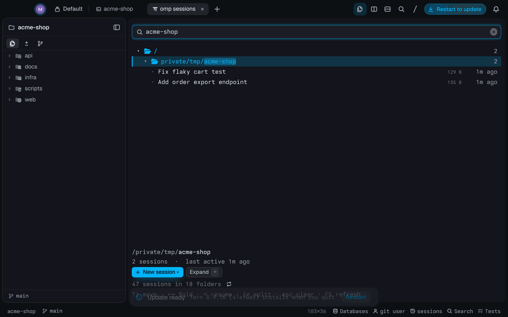
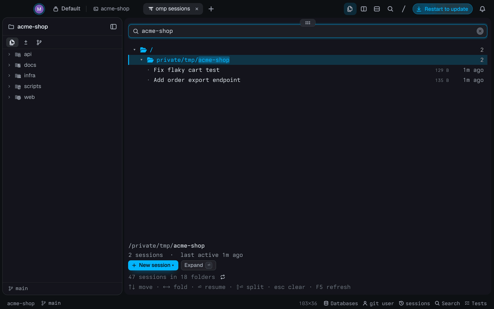

# omp Sessions

**Every omp session on this machine, as a folder tree, in [Tern](https://docs.stencil.so/tern/).**
omp's resume picker lists only the sessions started in the folder you're in. This browser shows
all of them, grouped by the folder each one was started in, and resumes any of them in a new
tab or a split.

<p align="center">
  
</p>

## Install

```sh
tern plugin install github.com/sneaky-bulgarian/tern-plugins/tern-omp-sessions
```

## Open it

- Status line: click **sessions** (shown when Settings › Status line is on), or press
  <kbd>⇧</kbd><kbd>⌘</kbd><kbd>H</kbd>. It opens on the focused pane's folder.
- Files pane: the clock button in its header opens it on the selected folder, else the folder
  the pane shows.
- Palette: **Browse omp sessions**.

A window has one browser: opening it again switches to it and jumps to the folder. A folder
without sessions jumps to the nearest folder above it that has some.

## What it shows

- Sessions in `~/.omp/agent/sessions`, re-read every 30 seconds and on <kbd>F5</kbd>.
  Subagent sessions are left out.
- Folders come from the working directory each session recorded. Your home folder shows as
  `~`, and a folder with no sessions of its own and a single subfolder merges with it
  (`~/Code`).
- Folder rows count the sessions below them. Session rows show the title, the size and when
  the session was last updated, newest first.

| Key | Does |
| --- | --- |
| typing | Filter by title, folder or session ID; folders with matches open |
| ↑ ↓, Page Up/Down, Home/End | Move |
| → ← | Open or close a folder, or step in and out |
| click | Select; on a folder, also open or close it |
| ⏎, double-click | Resume the session in a new tab |
| ⇧⏎ | Resume it in a split beside the browser |
| Esc, ⌫ | Close the New session menu or clear the filter, delete a character |
| F5 | Read the sessions again |

The dock has the same actions as buttons, plus **Copy ID** for a session and **New session ▾**
for a folder.

## Start a session in a folder

**New session ▾** on a folder's dock opens a menu that starts omp in a new tab:

- **Here**, or **Here in split** beside the browser.
- **In a subfolder**: the folder's subfolders, read from disk when the menu opens, so folders
  with no sessions yet are there too (hidden ones left out, first 24 shown).
- **In a worktree**: the folder's other git worktrees.

<p align="center">
  
</p>
<p align="center">
  
</p>

## How it works

`host.luau` is the `browser` block. One `sh` run of `find`, `stat` and `awk` lists the session
files with their size and modification time and prints only their `title` and `session`
header lines, so a scan costs the same however long the sessions are; the folder tree is built
from the headers' `cwd`.

A block can't open tabs, so to resume it opens an `omp-sessions://` link. `window.luau` claims
it with `tern.route.link` (only when it comes from the browser's own pane), opens a shell tab
or split in the session's folder and types `omp --resume '<file>'` into it. Going through the
shell runs the omp your shell finds, Tern's own included, and leaves you in that folder when
omp exits. `styles.css` draws the size column smaller.

## Develop

```sh
tern plugin link .          # reloads on every save
tern plugin types .         # tern.d.luau for luau-lsp
luau-lsp analyze --platform=standard --definitions=@tern=tern.d.luau *.luau
```
